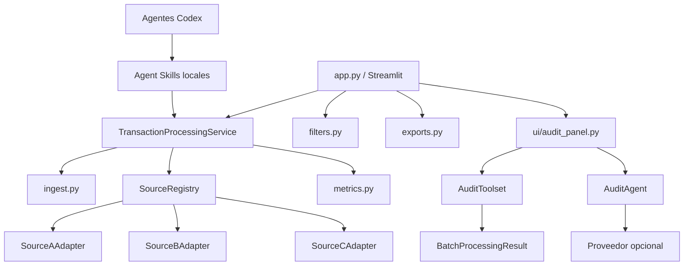

# FASE 2 — Refactorización de Transaction Normalizer

Fecha: 2026-11-22

## Objetivo

Separar responsabilidades del código existente sin cambiar el contrato
observable de normalización, métricas, exportaciones ni la interfaz Streamlit.
Esta fase no incorpora skills, agentes, proveedores LLM ni funcionalidades
visuales nuevas.

## Arquitectura anterior

Antes de la fase 2:

- `app.py` coordinaba la lectura, normalización, métricas, filtros y
  presentación.
- `normalizer.py` contenía detección de fuente, validación de campos, parsing
  de IDs, importes, monedas, estados y fechas en una sola unidad.
- Los resultados internos y públicos eran diccionarios sin modelos tipados.
- No existía un servicio de aplicación independiente de Streamlit.
- No existían adaptadores explícitos ni registro de fuentes.
- La lógica de filtrado vivía dentro de la función de UI.

El detalle de la línea base y sus resultados está en
[`docs/baseline.md`](baseline.md).

## Arquitectura nueva

```text
app.py
└── TransactionProcessingService
    ├── ingest.py
    ├── SourceRegistry
    │   ├── SourceAAdapter
    │   ├── SourceBAdapter
    │   ├── SourceCAdapter
    │   └── ConfiguredSourceAdapter (fallback configurable)
    ├── validation.py
    ├── metrics.py
    └── ProcessingResult

app.py ──> filters.py ──> resultados normalizados
                     └── exports.py
```

## Arquitectura consolidada después de las fases 3–6

La refactorización se mantuvo como base del sistema agéntico. Las skills y los
agentes inspeccionan o explican resultados, pero no sustituyen al servicio
determinista ni a las validaciones financieras.



La separación es deliberada: `TransactionProcessingService` procesa bytes o
registros sin depender de Streamlit; `AuditToolset` calcula únicamente salidas
agregadas de un resultado ya procesado; `AuditAgent` interpreta consultas con
un límite de iteraciones; y los agentes Codex coordinan revisiones del
repositorio. Ninguna de esas capas modifica transacciones o reglas
automáticamente.

### Módulos añadidos

- `models.py` ahora contiene `NormalizedTransaction`, `Diagnostic` y
  `BatchProcessingResult`.
- `validation.py` centraliza validaciones compartidas de IDs, importes,
  monedas, estados, fechas y diagnósticos.
- `sources/base.py` contiene el flujo común de validación de un adaptador.
- `sources/source_a.py`, `source_b.py` y `source_c.py` son puntos de extensión
  independientes para cada fuente.
- `sources/registry.py` detecta fuentes por discriminador y delega al
  adaptador correspondiente.
- `service.py` coordina ingestión, normalización y métricas sin importar
  Streamlit.
- `filters.py` contiene el filtrado y ordenamiento como función pura.
- `agent/` contiene `AuditAgent`, herramientas de solo lectura, prompts y el
  proveedor opcional desacoplado.
- `ui/` contiene el panel de auditoría y el estado de sesión asociado a la
  huella del lote, sin mover lógica financiera a Streamlit.

### Compatibilidad mantenida

La función pública sigue disponible:

```python
normalize_records(records, rules) -> ProcessingResult
```

`ProcessingResult.valid` e `invalid` siguen siendo listas de diccionarios con
las mismas claves. El servicio usa modelos tipados internamente y convierte al
formato histórico solo en el borde de compatibilidad.

## Decisiones de diseño

### Modelos tipados sin romper consumidores existentes

Se introdujeron dataclasses inmutables para el dominio interno:

- `NormalizedTransaction` conserva `Decimal` y el orden de los seis campos.
- `Diagnostic` evita transportar el registro original dentro de un error.
- `BatchProcessingResult` agrupa registros, resultado y métricas para el caso
  de uso de aplicación.

No se reemplazaron las listas de diccionarios de `ProcessingResult`, porque la
UI y las exportaciones existentes dependen de esa forma.

### Reglas de negocio configurables

Los adaptadores reciben la definición de su fuente desde `rules.json`. Los
mapas de estados, campos, formatos, monedas y límites no se copiaron a
constantes alternativas de Python.

El registro usa adaptadores explícitos para A, B y C. Si se añade una fuente
configurada con otro nombre y un contrato compatible, se crea un adaptador
genérico configurado; la incorporación de formatos realmente nuevos requerirá
un adaptador específico.

### Validaciones compartidas

El parsing común se movió a `validation.py` para evitar duplicar las reglas de
IDs, importes, monedas, estados y timestamps. La validación mantiene:

- `Decimal` para importes.
- Dos decimales sin redondear valores con precisión excesiva.
- Fechas de salida en UTC.
- Duplicados por `(source, id)`.
- Los códigos y mensajes de error existentes.

### Servicio independiente de Streamlit

`TransactionProcessingService` permite probar el caso de uso con bytes o con
registros directamente, sin inicializar la interfaz. `app.py` queda a cargo de
selección de datos, mensajes y representación visual.

### Filtros puros

`filter_valid_records` recibe filtros explícitos y devuelve una lista nueva.
Esto permite probar la intersección de estado, moneda, fuente, fechas e ID sin
simular widgets de Streamlit.

## Evidencia de validación de la FASE 2

Se ejecutaron:

```powershell
python -m unittest discover -s tests -v
python -m compileall -q app.py src tests
```

Resultado actual:

```text
13 tests ejecutados
13 OK
```

La suite incluye la caracterización original y pruebas nuevas para:

- Coordinación mediante `TransactionProcessingService`.
- Registro y detección de adaptadores.
- Modelo interno `NormalizedTransaction`.
- Filtros puros combinados.

El ejemplo integrado conserva:

```text
3 procesados
3 válidos
0 inválidos
USD 201.00
EUR 99.99
```

## Validación consolidada hasta la FASE 6

La evidencia posterior se mantiene separada de la caracterización de la FASE 2:

- FASE 3: 17 pruebas de skills, frontmatter, scripts y recursos.
- FASE 5: 29 pruebas del agente Python, proveedores y herramientas agregadas.
- FASE 6: 34 pruebas, incluyendo `AppTest`, consulta local, estado de sesión,
  disponibilidad del proveedor y carga del lote mixto.
- FASE 7: 36 pruebas, con cobertura adicional de carga mixta y consulta
  personalizada de importes por moneda.
- El ejemplo integrado conserva 3 procesados, 3 válidos, 0 inválidos, USD
  201.00 y EUR 99.99.
- El lote mixto conserva 9 procesados, 3 válidos y 6 inválidos.
- `compileall` y `regression-validator` pasan sin llamadas externas.

Los detalles y limitaciones están en `docs/skill-validation.md`,
`docs/agent-execution-evidence.md` y `docs/streamlit-integration.md`.

## Riesgos pendientes

- Los adaptadores A/B/C son actualmente especializaciones del flujo común y
  todavía no encapsulan comportamientos radicalmente distintos por fuente.
  Esto es intencional para no duplicar reglas durante esta fase.
- `ProcessingResult` continúa usando diccionarios en su frontera pública.
- La validación de configuración podría evolucionar hacia modelos tipados en
  una fase posterior, pero hacerlo ahora ampliaría el riesgo del contrato.
- La UI aún contiene detalles de presentación que podrían extraerse más
  adelante, pero ya no ejecuta ingestión, normalización ni filtrado de datos.
- El proveedor OpenAI opcional no se ha probado con credenciales ni red; solo
  se ha validado su contrato con un cliente falso y el bloqueo sin configuración.
- La selección de herramientas del runtime es determinista por palabras clave;
  no es un planificador autónomo de LLM.
- La verificación visual manual de Streamlit sigue siendo necesaria después de
  cada cambio importante de interfaz; `AppTest` no sustituye una inspección
  visual del navegador.

## Continuidad arquitectónica

Las skills, agentes Codex y el runtime Python deben mantenerse como capas de
inspección y explicación. No deben reemplazar las validaciones deterministas,
ejecutar instrucciones contenidas en transacciones, ni convertir
recomendaciones en cambios de negocio sin revisión humana. Las decisiones de
validez, precisión monetaria, fechas, duplicados y exportación continúan siendo
deterministas y verificables mediante pruebas.
